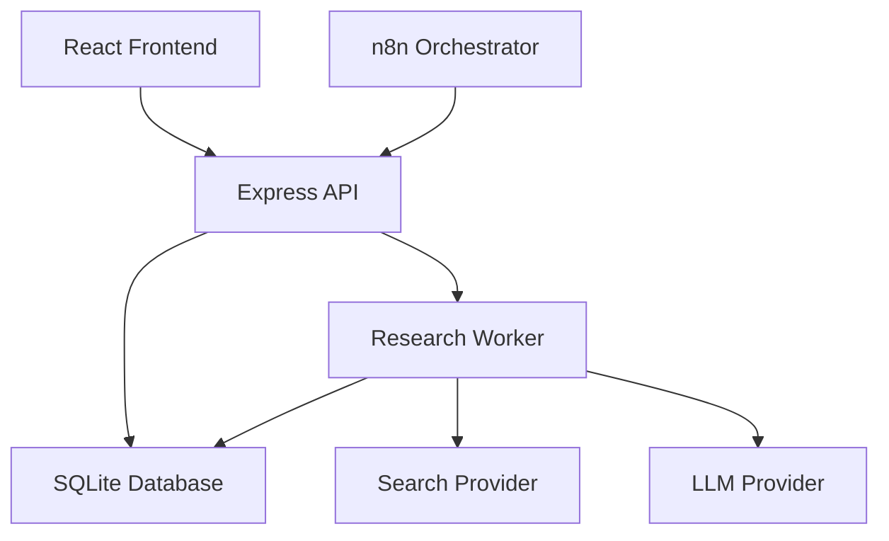

# AI Research Agent

## Giới thiệu

AI Research Agent là trợ lý nghiên cứu có pipeline xử lý nền, lưu bằng chứng và báo cáo theo từng lần chạy. Bạn có thể bắt đầu từ frontend hoặc điều phối qua n8n; backend luôn quản lý trạng thái và dữ liệu chính.

Dự án hỗ trợ:

- Nhận chủ đề, mục tiêu, phạm vi và yêu cầu đầu ra.
- Tạo kế hoạch nghiên cứu bằng AI.
- Tìm kiếm nguồn trên Internet, chuẩn hóa URL và loại nguồn trùng.
- Thu thập và làm sạch nội dung.
- Dịch nội dung hiển thị sang tiếng Việt, giữ nguyên nội dung gốc.
- Chia nội dung thành các chunk và phân tích bằng chứng có nguồn gốc truy xuất được.
- Đánh giá độ đầy đủ của bằng chứng và tìm kiếm bổ sung khi còn thiếu.
- Tạo báo cáo có trích dẫn, kiểm tra citation và lưu lịch sử phiên bản.
- Xuất từng phiên bản báo cáo ra DOCX và PDF.
- Theo dõi tiến trình, xem nguồn/bằng chứng/báo cáo, retry hoặc hủy lần chạy.

Flow v2 là luồng hiện hành. Các API và màn hình workflow v1 vẫn được giữ để hỗ trợ migration.

## Kiến trúc hệ thống

Dự án sử dụng **modular monolith**, chưa tách microservice:

| Thành phần | Vai trò |
| --- | --- |
| React + Vite + React Router | Dashboard, tạo nghiên cứu, theo dõi tiến trình và xem kết quả |
| Node.js + Express | Validation, API public/internal, quản lý request/run và lên lịch job |
| SQLite | Lưu request, trạng thái run/job, phiên bản nguồn, analysis, report và event |
| Research Worker | Claim và xử lý job; có thể chạy bằng process riêng trong cùng repository |
| n8n Orchestrator | Gọi API, dispatch job, chờ và theo dõi kết quả; không tự quyết định dữ liệu nghiệp vụ |
| Tavily / Search Provider | Tìm kiếm nguồn; provider hiện được tích hợp là Tavily |
| Gemini / LLM Provider | Lập kế hoạch, dịch và trích xuất bằng chứng; provider hiện được tích hợp là Gemini |
| Docker Compose | Chạy frontend, backend, worker và n8n với volume và healthcheck |



Mũi tên API → Worker biểu diễn việc lên lịch qua SQLite, không phải lời gọi trực tiếp giữa hai process. Backend và worker phải sử dụng cùng database. Frontend production gọi `/api` qua Nginx cùng origin.

## Pipeline nghiên cứu

```text
Research request → Research run
→ Planning
→ Collecting: tìm nguồn → làm sạch → dịch hiển thị → chunking
→ Analyzing: trích xuất và kiểm tra nguồn gốc bằng chứng
→ Evaluating: đánh giá độ phủ
    → Search more nếu còn thiếu và còn ngân sách
    → Quay lại Collecting → Analyzing → Evaluating
→ Composing: tổng hợp từ analysis version hiện tại
→ Verifying: kiểm tra citation
→ Completed hoặc Partial
```

- Run có trạng thái `queued`, `running`, `completed`, `partial`, `failed`, `cancelled`.
- Job có trạng thái `queued`, `running`, `succeeded`, `retry_waiting`, `failed`, `cancelled`.
- Tối đa **2 vòng tìm kiếm bổ sung**, **30 nguồn**, **16 lượt HTTP search** và **32 lượt HTTP LLM** trên mỗi run, tính cả retry provider.
- Mỗi lượt gọi provider có timeout 30 giây; mỗi stage có deadline 8 phút.
- Coverage chỉ đủ khi mọi câu hỏi có bằng chứng truy xuất được và có ít nhất hai source version được trích dẫn để đối chiếu. Việc này không thay thế đánh giá độc lập về tính đúng đắn của nguồn.
- Không có bằng chứng hoặc citation không hợp lệ thì run không được trả `completed`.

## Cấu trúc repository

```text
backend/
  src/
    config/          # SQLite và khởi tạo database
    controllers/     # HTTP handlers
    routes/          # API legacy và Flow v2
    services/        # Nghiệp vụ, provider legacy, export
    models/          # Truy vấn request/run và dữ liệu liên quan
    migrations/      # Migration v2 có version
    jobs/            # Sáu stage handler
    workers/         # Claim, lease, heartbeat, recovery và worker entrypoint
    providers/       # Provider cho Flow v2
    validators/      # Validation input và schema evaluator
    utils/           # Retry, URL, ngôn ngữ và tiện ích
  test/
frontend/
  src/
    pages/           # Dashboard, tạo nghiên cứu, tiến trình và màn hình legacy
    components/      # Layout và thành phần giao diện
    hooks/           # State và polling
    services/        # HTTP clients
    config/
    utils/
  tests/             # Playwright
n8n/workflows/v2/     # Bảy workflow hiện hành
n8n/workflows/        # Workflow legacy và hướng dẫn cũ
docs/                # Thiết kế, API, migration và báo cáo kiểm thử
```

## Yêu cầu môi trường

- Node.js **22.x**, khuyến nghị từ **22.14.0**. Backend giới hạn engine ở nhánh 22; frontend cần từ 22.12.
- npm và Git.
- Docker Engine cùng Docker Compose nếu chạy bằng container.
- Gemini API key và Tavily API key nếu dùng provider thật.

Các Dockerfile pin Node và Nginx; Compose pin n8n. Không cần cài SQLite server riêng.

## Cài đặt và chạy local

Tại thư mục repository:

```bash
npm --prefix backend ci
npm --prefix frontend ci
```

Tạo file cấu hình **chỉ nếu chưa tồn tại**, tránh ghi đè cấu hình đang dùng:

```bash
[ -f backend/.env ] || cp backend/.env.example backend/.env
[ -f frontend/.env ] || cp frontend/.env.example frontend/.env
```

Mở ba terminal:

```bash
# Terminal 1: API
cd backend
npm start
# Hoặc npm run dev để tự khởi động lại khi sửa code.
```

```bash
# Terminal 2: worker
cd backend
npm run worker
```

```bash
# Terminal 3: frontend
cd frontend
npm run dev
```

- Frontend: <http://localhost:5173>.
- Backend health: <http://localhost:3000/health>.
- Trong frontend, chọn **Nghiên cứu tự động** hoặc mở `/research/new`.

Vite proxy `/api` và `/health` về backend khi phát triển. Để `VITE_API_BASE_URL=` nếu dùng cùng origin. Nếu file `.env` cũ vẫn đặt URL riêng, ứng dụng tiếp tục dùng URL đó.

## Biến môi trường

| Biến | Ý nghĩa |
| --- | --- |
| `PORT` | Port backend; mặc định 3000 |
| `RESEARCH_DB_PATH` | Đường dẫn SQLite; mặc định `backend/data/research.db` |
| `FRONTEND_ORIGIN` | Origin frontend được CORS cho phép |
| `INTERNAL_API_KEY` | Secret cho internal API; backend và n8n phải dùng cùng giá trị |
| `MOCK_LLM` | `true` để dùng planner mô phỏng; `false` để gọi Gemini |
| `MOCK_SEARCH` | `true` để dùng nguồn mô phỏng; `false` để gọi Tavily |
| `GEMINI_API_KEY` | Gemini API key, chỉ đặt phía backend/worker |
| `GEMINI_MODEL` | Model Gemini; mặc định `gemini-2.5-flash` |
| `TAVILY_API_KEY` | Tavily API key, chỉ đặt phía backend/worker |
| `VITE_API_BASE_URL` | URL public của backend khi frontend không dùng cùng origin |

Để dùng provider thật, cấu hình trong `backend/.env` rồi khởi động lại cả API và worker:

```dotenv
MOCK_LLM=false
MOCK_SEARCH=false
LLM_PROVIDER=gemini
SEARCH_PROVIDER=tavily
GEMINI_API_KEY=YOUR_GEMINI_KEY
GEMINI_MODEL=gemini-2.5-flash
TAVILY_API_KEY=YOUR_TAVILY_KEY
```

Mock được dùng cho phát triển và kiểm thử, có nhãn dữ liệu mô phỏng. Flow v2 không biến nguồn mock thành bằng chứng thực tế; run mock kết thúc `partial`. Các biến cấu hình legacy khác được mô tả trong `backend/.env.example`; giới hạn pipeline v2 nằm trong implementation và không tự thay đổi theo mọi biến legacy.

Không commit `.env`, database hoặc credential. Không đặt API key trong biến `VITE_*`, vì các biến này xuất hiện trong bundle trình duyệt.

## Chạy bằng Docker Compose

Chuẩn bị `backend/.env` như phần local. Tạo `.env` tại root **nếu chưa có**:

```bash
[ -f .env ] || cp .env.example .env
```

Thay placeholder `INTERNAL_API_KEY` bằng secret ngẫu nhiên. Có thể tạo một giá trị bằng:

```bash
openssl rand -hex 32
```

Root `.env` được Git bỏ qua. Compose truyền cùng internal key cho backend và worker; cấu hình HTTP Header Auth của n8n phải dùng giá trị này.

```bash
docker compose config --quiet
docker compose build
docker compose up -d
docker compose ps
curl http://localhost:3000/health
curl http://localhost:8080
```

| Service | URL local |
| --- | --- |
| Frontend | <http://localhost:8080> |
| Backend | <http://localhost:3000> |
| n8n | <http://localhost:5678> |

Worker không cần public port. Database và cấu hình n8n được lưu trong named volume. Các port public được bind vào loopback. Không chạy `down -v` nếu cần giữ dữ liệu.

Nếu các cổng trên đã được stack khác sử dụng, có thể chạy môi trường kiểm thử mock cách ly bằng override:

```bash
docker compose -p ai-research-flow-v2-check \
  -f docker-compose.yml -f docker-compose.validation.yml up -d --build
```

Override dùng frontend **18080**, backend **13000**, n8n **15678** và bật mock provider. Project name riêng tạo các volume riêng. Compose cần hỗ trợ cú pháp `!override` trong file này.

## API Flow v2

Mọi response thành công được bọc trong `{ "success": true, "data": ... }`. Lỗi trả `{ "success": false, "error": ... }`.

| Method | Endpoint | Chức năng |
| --- | --- | --- |
| POST | `/api/research` | Tạo request cơ bản với `executionMode: "async"` |
| GET | `/api/research` | Danh sách tối đa 200 request gần nhất và latest run |
| POST | `/api/research/:requestId/runs` | Tạo run, trả HTTP 202; yêu cầu `Idempotency-Key` |
| GET | `/api/research/:requestId/runs/:runId/progress` | Trạng thái, stage, vòng, job, phần trăm, số lượng và event |
| POST | `/api/research/runs/:runId/retry` | Retry run failed/partial; optional `stage`, yêu cầu `Idempotency-Key` |
| POST | `/api/research/runs/:runId/cancel` | Hủy run |
| GET | `/api/research/runs/:runId/sources` | Nguồn bất biến của run |
| GET | `/api/research/runs/:runId/evidence` | Analysis hiện tại và bằng chứng |
| GET | `/api/research/runs/:runId/reports` | Các phiên bản báo cáo |
| GET | `/api/research/reports/:reportId/export/docx` | Xuất DOCX theo report version |
| GET | `/api/research/reports/:reportId/export/pdf` | Xuất PDF theo report version |
| POST | `/internal/runs/:runId/jobs` | Dispatch job đã được backend lên lịch |
| GET | `/internal/jobs/:jobId?runId=...` | Theo dõi job, kiểm tra job thuộc run |

Ví dụ tạo request:

```bash
curl -X POST http://localhost:3000/api/research \
  -H 'Content-Type: application/json' \
  -d '{"topic":"An toàn AI","goal":"Tổng hợp bằng chứng","scope":"Nguồn web công khai","outputLength":"medium","executionMode":"async"}'
```

Dùng `data.requestId` để tạo run:

```bash
curl -X POST http://localhost:3000/api/research/REQUEST_ID/runs \
  -H 'Content-Type: application/json' \
  -H 'Idempotency-Key: client-run-001' \
  -d '{"language":"vi","numberOfSources":12,"searchMore":true}'
```

Gửi lại cùng request/key/input trả cùng run; thay input với cùng key trả 409. Retry sau lỗi kết nối cần giữ key cũ. Nếu đã hết ngân sách provider của run, tạo run mới để có ngân sách mới.

Internal API yêu cầu header `X-Internal-Api-Key`. POST dispatch còn yêu cầu canonical `Idempotency-Key` lấy từ `progress.currentJob.idempotency_key`. Xem [API và vận hành](docs/FLOW_V2_API.md) để biết chi tiết.

## Frontend

| Route | Nội dung |
| --- | --- |
| `/` | Dashboard lấy danh sách request và trạng thái run từ backend |
| `/research/new` | Form tạo nghiên cứu và chạy pipeline tự động |
| `/research/:requestId/runs/:runId` | Tiến trình, event, tab nguồn/bằng chứng/báo cáo, retry/cancel và export |
| `/workflow-1`, `/workflow-2`, `/workflow-3`, `/workflow-4` | Các màn hình legacy được giữ trong giai đoạn migration |

Polling có backoff, dừng khi run ở trạng thái cuối, tối đa 240 lượt quan sát hoặc 6 lỗi kết nối liên tiếp. Có nút kết nối lại. Reload trang khôi phục từ requestId/runId trong URL, không tạo run mới. Dashboard v2 không dùng localStorage làm nguồn dữ liệu chính; màn hình legacy vẫn giữ metadata điều hướng cũ.

## n8n workflows

Các workflow hiện hành nằm trong [`n8n/workflows/v2/`](n8n/workflows/v2/):

1. `create-run.json`
2. `planning-orchestrator.json`
3. `collecting-orchestrator.json`
4. `analysis-orchestrator.json`
5. `evaluation-loop.json`
6. `report-orchestrator.json`
7. `full-research-pipeline.json`

Import workflow, lưu trong editor rồi publish. Gán credential **HTTP Header Auth** cho các node gọi internal API: header `X-Internal-Api-Key`, giá trị bằng key của backend. Không ghi key trực tiếp vào JSON. Bật authentication cho webhook khi triển khai ra ngoài môi trường local.

Tạo request async trước, sau đó gửi webhook full pipeline:

```json
{
  "requestId": "REQUEST_ID",
  "idempotencyKey": "stable-client-key",
  "options": {
    "language": "vi",
    "numberOfSources": 12,
    "searchMore": true
  }
}
```

Webhook production sau khi publish: `POST /webhook/research-v2/full-research-pipeline` trên n8n. Workflow full tạo run ở chế độ `orchestration: "n8n"`, dispatch stage đã được backend lên lịch, chờ, poll job, kiểm tra nhánh search-more và trả kết quả cuối. Worker xử lý nghiệp vụ; n8n chỉ phát lệnh và quan sát. Nếu n8n dừng, stage tiếp theo chờ dispatch để có thể tiếp tục an toàn.

Các orchestrator theo stage nhận thêm `runId` để tiếp tục một run hiện có; chúng có thể theo dõi và giải phóng các stage tiếp theo, không chỉ stage trong tên file. Replay full với cùng request/options/key giữ nguyên run và report. Workflow có giới hạn polling và thời gian thực thi.

Trong n8n 2.0.3, CLI import chưa tạo publication history cần cho CLI publish; lưu qua editor/API trước khi publish. Hướng dẫn đầy đủ: [n8n Flow v2](n8n/workflows/v2/README.md).

## Database, migration và độ bền

Migration `002-flow-v2` chạy transaction khi khởi tạo database, ghi nhận trong `schema_migrations` và bổ sung:

- `research_runs`, `stage_jobs`, `dispatch_outbox`.
- `source_versions`, `source_chunks_v2`.
- `analysis_versions`, `report_versions`, `run_events`.

Migration không xóa dữ liệu legacy. Mỗi run giữ input snapshot riêng. Chạy lại analysis/report tạo phiên bản mới; nội dung report cũ được giữ và đánh dấu `historical`. Bằng chứng đã kiểm chứng trong cùng run được giữ khi provider lỗi ở vòng sau, nếu câu hỏi và provenance vẫn phù hợp.

Worker dùng transaction `BEGIN IMMEDIATE`, lease 30 giây và heartbeat mỗi 5 giây. Kiểm tra owner/generation/lease trước khi commit ngăn worker hết hạn ghi kết quả. Job có recovery và retry có giới hạn. SQLite sử dụng WAL và busy timeout 5 giây. Việc lưu kết quả, event và job tiếp theo được thực hiện atomically.

Trước nâng cấp, dừng worker và sao lưu SQLite nhất quán. Backend/worker phải trỏ cùng file database. Không tự động chuyển evidence legacy sang v2 vì thiếu provenance cần thiết; có thể tạo run v2 mới từ request hiện có. Hướng dẫn: [Kế hoạch triển khai và migration](docs/REBUILD_IMPLEMENTATION_PLAN.md).

## Bảo mật và xử lý lỗi

- Internal API có key, so sánh an toàn và kiểm tra run/job.
- Endpoint tạo run/retry có rate limit; JSON body giới hạn 128 KB và được validate.
- Provider có timeout, retry exponential backoff và ngân sách bền vững theo run.
- URL nguồn được chuẩn hóa; kiểm tra địa chỉ private/localhost và đích redirect trước khi tải nội dung.
- Lỗi provider trả thông báo an toàn; không trả API key hoặc raw provider error.
- CORS theo môi trường; Nginx production proxy API cùng origin.
- Backend và worker xử lý graceful shutdown; cancel chặn commit của job đang chạy.

Public research API giữ mô hình chưa có tài khoản/phân quyền của repository. Khi mở ra Internet, cần bổ sung access control ở ứng dụng hoặc reverse proxy; internal key không thay thế quyền truy cập của người dùng cuối.

## Kiểm thử

Từ repository root:

```bash
npm --prefix backend test
npm --prefix frontend run build
npm --prefix frontend run test:e2e
docker compose config --quiet
```

Playwright cần Google Chrome hoặc cấu hình `PLAYWRIGHT_CHROME_PATH` trỏ tới browser phù hợp. Browser tests tự chạy backend/frontend trên port 4300/4173, dùng SQLite tạm và mock provider. Backend tests cũng sử dụng database tạm, không gọi Gemini/Tavily thật. Môi trường chạy test cần cho phép mở local HTTP server và process con.

Kết quả kiểm thử của Flow v2: **78 test backend**, **11 test trình duyệt** đạt; frontend build và Docker config/build/up đạt. Webhook n8n thực tế đã kiểm tra đủ sáu stage, replay giữ cùng run/report và search-more dừng sau hai vòng. Chi tiết môi trường, tình huống và giới hạn nằm trong [báo cáo kiểm thử](docs/REBUILD_VALIDATION.md).

## Giới hạn hiện tại

- Các lượt kiểm thử nêu trên chưa gọi Gemini/Tavily trả phí. Nghiên cứu thực tế cần key, quota và kiểm chứng kết quả với provider thật.
- Evaluator kiểm tra độ phủ, số nguồn đối chiếu và cờ xung đột từ bằng chứng; chưa phải dịch vụ fact-checking hay peer review độc lập.
- Report tổng hợp có cấu trúc từ evidence hiện tại; độ dài điều khiển mật độ bằng chứng, không bảo đảm số trang cố định.
- Thu thập nội dung hiện tập trung HTML/text. PDF nguồn và trang cần JavaScript chưa có bộ trích xuất chuyên dụng.
- API legacy vẫn đồng bộ và có dữ liệu mutable; dùng API theo run để có version history và worker v2.

## Tài liệu liên quan

- [API, vận hành và rollback](docs/FLOW_V2_API.md)
- [Kiến trúc và kế hoạch migration](docs/REBUILD_IMPLEMENTATION_PLAN.md)
- [Kết quả kiểm thử Flow v2](docs/REBUILD_VALIDATION.md)
- [Cấu hình workflow n8n](n8n/workflows/v2/README.md)
