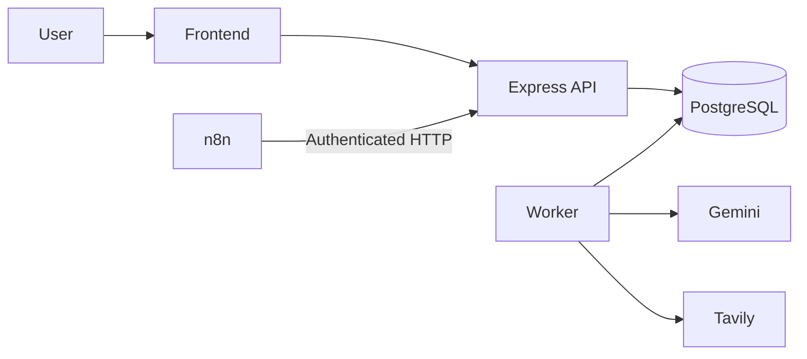

# AI-Research-Agent — ResearchOS

ResearchOS gồm Node.js/Express Backend, PostgreSQL, Research Worker và Frontend hiện có. Gemini lập kế hoạch/phân tích, Tavily tìm nguồn; n8n chỉ điều phối qua HTTP. PostgreSQL là database runtime duy nhất của ResearchOS. SQLite gốc chỉ phục vụ migration/rollback offline; không import hoặc cutover lại.

**Trạng thái triển khai:** source đã tích hợp năm workflow và Scheduled Research. Audit runtime ngày 2026-11-09 ghi nhận Backend/Worker/PostgreSQL healthy nhưng mới có migrations001–003, chưa có schedule module trong image đang chạy và chưa cấu hình automation user. Không coi health200 là đủ điều kiện Publish WF01–WF05. Xem [deployment readiness](docs/n8n-redesign/DEPLOYMENT_READINESS.md).

## Kiến trúc và chức năng



Research đi qua planning → collecting → analyzing → evaluating → composing → verifying. Backend giữ quyền sở hữu, sequencing, idempotency, lease/retry/recovery, evidence và citation validation. Chế độ backend để Worker tự tiến; chế độ n8n chờ authenticated dispatch từng job. HTTP202 là accepted, không phải completed. Không tạo evidence/citation giả trong live mode.

Chức năng hiện có gồm tài khoản/session/user ownership, nghiên cứu và report version/export Word/PDF, PDF ingestion và full-text RAG, Research Chat, Agent Memory có review, Scheduled Research có quota/concurrency và dispatch ledger. Frontend hiện có được giữ nguyên.

## Cấu trúc

- `backend/src/`: API, PostgreSQL layer/migrations, providers, knowledge, schedules và Worker.
- `backend/test/`: unit/integration tests, PostgreSQL isolation và mock fixtures.
- `frontend/`: giao diện hiện có.
- `n8n/workflows/researchos-realigned/`: năm workflow JSON chính thức.
- `scripts/`: vận hành, backup, n8n bundle và engine checks.
- `docs/`: deployment, security, API contracts, migration và verification records.

## Cấu hình và Docker

Node22–24, PostgreSQL18 theo Compose và Docker Compose phù hợp với cấu hình hiện có. Các file `.env.example`, `backend/.env.example`, `deploy/release.env.example` là mẫu không chứa secret thật. Đặt secret trong file riêng được ignore; không commit `.env`, key hoặc dump.

Backend/Worker phải cùng PGHOST/PGPORT/PGDATABASE/PGUSER. Dùng `PGPASSWORD_FILE` cho mật khẩu; PostgreSQL có persistent volume và healthcheck, không cần publish port ra Internet. Chỉ sử dụng cấu hình sau khi xác định đúng project/volumes và backup hiện có.

```sh
# Read-only: kiểm tra cấu hình và trạng thái
 docker compose -p ai-research-agent config --quiet
 docker compose -p ai-research-agent ps
```

Quy trình operator cho **deployment đã được phê duyệt**, không phải lệnh tự sửa stack đang phục vụ:

```sh
# Sau backup, review release và cấu hình secrets
 docker compose -p ai-research-agent build backend worker
 docker compose -p ai-research-agent up -d postgres
 docker compose -p ai-research-agent run --rm migrate
 docker compose -p ai-research-agent up -d backend worker frontend
```

Migration service dùng version/checksum tracking; không edit migration đã áp dụng. Source có001–004; production cần004 trước WF05. Không dùng `down -v`, không reset volume, không chạy SQLite import để khởi động. Production TLS/mTLS, networks, release config và rollback: [operations runbook](docs/PRODUCTION_OPERATIONS.md), [PostgreSQL deployment/backup/rollback](docs/POSTGRESQL_MIGRATION_REPORT.md). Không trộn production/development project và volumes.

Local development: cài dependencies bằng `npm ci` trong backend/frontend, cấu hình PostgreSQL test/dev riêng và env theo mẫu. Chạy `npm --prefix backend run db:migrate` trên DB đã chọn, rồi `npm --prefix backend start`, `npm --prefix backend run worker` và `npm --prefix frontend run dev` trong các terminal riêng. Không dùng DB production làm môi trường thử.

## Năm workflow chính thức

| File trong `n8n/workflows/researchos-realigned/` | Trigger |
|---|---|
| `WF01-full-research.json` | POST `/webhook/researchos/wf01/full-research` |
| `WF02-document-processing.json` | POST `/webhook/researchos/wf02/document-processing` |
| `WF03-research-chat.json` | POST `/webhook/researchos/wf03/research-chat` |
| `WF04-memory-maintenance.json` | Schedule6h; không approve memory |
| `WF05-scheduled-research.json` | Daily window Asia/Ho_Chi_Minh; RESEARCHOS_SCHEDULE_ID |

Năm export inactive; 14JSON legacy đã gỡ khỏi source, không tự xóa workflow trong n8n database/Cloud. Inbound Header Auth và outbound X-Internal-Api-Key dùng hai secret riêng qua credential system. Cần active INTERNAL_RESEARCH_USER_ID đúng ownership. Self-hosted cùng network dùng Backend Docker URL; Cloud phải có secured HTTPS gateway allowlist. Không public toàn bộ Internal API.

Xem [Cloud/self-hosted setup](docs/n8n-redesign/CLOUD_SETUP.md), [API integration](docs/n8n-redesign/INTEGRATION_REPORT.md), [legacy replacement và rollback](docs/n8n-redesign/FINAL_WORKFLOW_REPLACEMENT.md). Không Publish lịch hoặc gọi provider live trước khi operator hoàn tất readiness checklist.

## APIs, authentication và vận hành

Public APIs yêu cầu session; write requests giữ Origin/CSRF checks. Internal API dùng service key và scope kiểm tra ở Backend, không nhận owner do webhook tự chọn. Cấu hình HTTPS cookies/trusted proxy và password policy: [authentication](docs/authentication.md).

- [Research Run/Jobs/Progress/Retry/Cancel/Reports](docs/FLOW_V2_API.md)
- [PDF, Chat, RAG và Agent Memory](docs/knowledge-workspace.md)
- [Schedule API, quotas và idempotency](docs/n8n-redesign/INTEGRATION_REPORT.md)
- [Security hardening](docs/PRODUCTION_HARDENING_REPORT.md)

Health `/health/ready` hiện chỉ kiểm tra PostgreSQL và migration002; phải đối chiếu ledger004 và deployed code riêng trước WF05.

## Kiểm thử

Dùng PostgreSQL test database riêng theo [test checklist](docs/n8n-redesign/TEST_CHECKLIST.md); test preload tách schemas, không dùng production fixtures. Không gọi Gemini/Tavily thật trong regression.

```sh
# Chạy khi PG* trỏ tới database test được phép
npm --prefix backend test
node --test backend/test/researchos-workflows.test.js
python3 -m unittest discover -s scripts/ops -p 'test_*.py' -v
```

Bằng chứng phiên integration:166Backend tests và8isolated n8n engine scenarios PASS. Đây không phải kết quả chạy lại trong phiên documentation cleanup, không chứng minh Cloud webhook transport/credential bindings. Kết quả phiên hiện tại và blockers nằm trong [readiness report](docs/n8n-redesign/DEPLOYMENT_READINESS.md).

## Tài liệu khôi phục và audit

Giữ [migration progress](docs/POSTGRESQL_MIGRATION_PROGRESS.md), [migration report](docs/POSTGRESQL_MIGRATION_REPORT.md), inventories/manifests/checksums trong `docs/database/`, và lịch sử migrations offline. Không xóa SQLite backups, PostgreSQL dumps, PDF storage hoặc n8n volumes. Báo cáo/tài liệu cũ chỉ được gỡ sau durable backup SHA-256; danh mục KEEP/UPDATE/DELETE/ARCHIVE và vị trí backup ở readiness report.

## Frontend ResearchOS

Frontend React/Vite dùng session cookies, API public và cấu hình `VITE_API_BASE_URL` hiện có. Chạy `npm --prefix frontend run dev` (mặc định proxy `/api` và `/health` tới `127.0.0.1:3000`). `FRONTEND_ORIGIN` của Backend phải khớp chính xác origin trên browser để CSRF cho phép thao tác ghi.

```sh
npm --prefix frontend run build
npm --prefix frontend run test:rebuild
# Chỉ build Frontend; không khởi động hay migrate các dịch vụ khác
 docker build -t researchos-frontend-rebuild:local frontend
```

`test:rebuild` dùng API mock, không cần database, không gọi Gemini/Tavily. Cần Chrome hoặc `PLAYWRIGHT_CHROME_PATH` trỏ đến Chromium đã cài. Bộ `test:legacy` cần PostgreSQL test cô lập; launcher từ chối khởi tạo nếu thiếu cấu hình test. Giới hạn API, mapping WF01–WF05, kết quả kiểm thử và hướng dẫn Docker: [Frontend rebuild report](docs/FRONTEND_REBUILD_REPORT.md). Build thành công không chứng minh Backend mới hoặc n8n Cloud đã được deploy.


### Giao diện theo ResearchOS Interactive Demo

Bản React hiện dùng thiết kế tại `design/reference/researchos_demo/`: sidebar navy, banner, bốn số liệu thật, năm thẻ chức năng và Knowledge Workspace. Mục **Tự động hóa (n8n)** ở `/automations`; `/schedules` và các routes nghiên cứu/PDF/Chat/Memory cũ được giữ. Search `Ctrl/Cmd+K`, tạo nghiên cứu `Ctrl/Cmd+N`, Escape đóng hộp thoại. Các thao tác dùng API public có session; không đưa logic seed/localStorage hay webhook secret của demo vào ứng dụng.

Mapping demo/API/WF01–WF05, giới hạn và kết quả build/test/screenshot: [Demo rebuild report](docs/RESEARCHOS_DEMO_REBUILD_REPORT.md). `npm --prefix frontend run test:rebuild` kiểm tra cả regression trước đó và giao diện demo bằng API mock; suite E2E/Backend thật vẫn cần PostgreSQL test cô lập. Không cần sửa Docker production để chạy các kiểm thử này.
