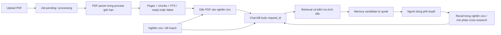
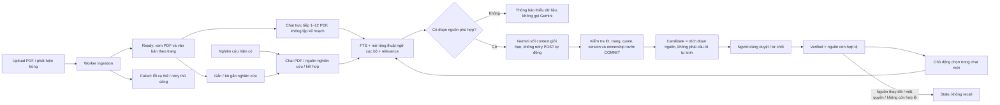

# PDF, Trò chuyện AI và Bộ nhớ AI — báo cáo cải tiến

Ngày **07/11/2026** (Asia/Ho_Chi_Minh). HEAD khi thực hiện: `49b448cb441ff0ff409cf4f1a146a42fd2a61e67`, branch `main`. Working tree có sẵn các bản sửa source relevance; đã giữ lại chúng. Kết quả dưới đây áp dụng cho working tree chưa commit, không phải chỉ HEAD.

Không chạy trên SQLite/PDF storage người dùng, không thay `.env`, Docker/volumes hoặc container đang chạy; không commit/push/merge/deploy. Tests dùng database, PDF fixtures và provider mock riêng. Không gọi Gemini/Tavily trả phí.

## 1. Kiến trúc trước và các điểm bất tiện

Đã rà soát Knowledge services (`documents`, `ingestion`, `pdf-child`, `chat`, `retrieval`, `memory`, `routes`, `common`), migrations và test liên quan, frontend PDF/chat/memory, Auth boundary và ba workflow Knowledge n8n.

Các ràng buộc và vấn đề đã xác định:

- `chat_sessions.request_id` và `agent_memories.request_id` đều NOT NULL; chat PDF phải có nghiên cứu và PDF đã attach. Người dùng chỉ muốn đọc PDF vẫn phải đi qua một luồng nghiên cứu.
- Trang `/chat` trước đây chỉ là picker nghiên cứu; lịch sử chỉ hiện theo nghiên cứu, không có nơi mở chat PDF độc lập.
- Polling GET mỗi 2,2 giây vẫn tiếp tục khi tài liệu đã ready và hội thoại đã complete. Văn bản trang có thể hiện thông báo “không có lớp văn bản” trong lúc thực sự đang loading.
- Thông tin giới hạn upload hardcode trên frontend, có thể khác cấu hình backend.
- Khi POST chat trả lỗi mạng, frontend tạo clientToken mới cho lần gửi lại: câu trả lời có thể đã lưu nhưng người dùng gửi thêm một lượt tính phí.
- Chat chỉ trả 100 tin mới nhất, không có cursor để xem lịch sử cũ dù dữ liệu còn trong SQLite.
- Memory đã có cơ chế extractive quote, ownership, phiên bản và stale. Tuy nhiên approve kiểm tra nguồn trước UPDATE, chưa bảo đảm cùng một transaction; candidate helper cũng chưa tự kiểm tra quote thực sự có trong nguồn. Việc kiểm tra nội dung memory khớp quote cần chặt hơn.
- Candidate, verified, rejected và stale đã có sẵn; không cần tạo hệ thống memory mới hoặc tự động xác minh nội dung AI sinh ra.
- n8n chỉ quan sát ingestion, gửi chat nghiên cứu qua internal API có key và kiểm tra stale memory định kỳ. Luồng cốt lõi không phụ thuộc n8n.

## 2. Luồng sau cải tiến

### PDF

- Giữ parser process riêng, giới hạn RAM/thời gian, job lease/generation fencing, FTS, kiểm tra file/size/pages/duplicate/hash và ownership hiện có.
- Thư viện và trang chi tiết tự làm mới khi `pending/processing`, dừng khi `ready/failed`; retry thủ công sẽ bắt đầu poll lại.
- `GET /api/knowledge/config` trả giới hạn tải lên/số trang thật và `ocr:false`, không chứa secrets. Frontend không còn khẳng định OCR hoặc luôn giả định backend là 20 MB/100 trang.
- Upload thành công hoặc trùng có liên kết “Xem tài liệu vừa tải”. PDF ready có nút “Chat với PDF này”, mở form đã chọn PDF, không tự POST.
- Xem PDF qua authenticated blob, chọn trang và văn bản trang; loading/error/empty được phân biệt. Giữ gắn/bỏ gắn nghiên cứu, thêm chọn nghiên cứu theo chủ đề từ backend thay vì chỉ phải nhập mã.
- Scan PDF vẫn báo `OCR_REQUIRED`; encrypted/corrupt/page limit/time limit giữ lỗi cụ thể. Không triển khai OCR giả và không xóa PDF cũ.

### Chat

- `/chat` là không gian chat PDF/bộ nhớ; `/chat/:chatId` mở session trực tiếp. Chọn một/nhiều PDF ready hoặc kết hợp với memory đã xác minh; có thể dùng riêng memory đủ điều kiện đã chủ động chọn.
- Các đường `/research/:requestId/chat[/chatId]` vẫn giữ nguyên PDF, research sources/evidence và combined scopes. Lịch sử chung dẫn chat cũ về đúng nghiên cứu.
- API mới `POST /api/chats`, `GET /api/chats`, `GET /api/chats/:id`; endpoint messages/delete cũ tái sử dụng. Chat trực tiếp từ chối scope research hoặc requestId tùy ý; tạo chat không tạo request/plan và không gọi Gemini.
- Chọn nguồn khác tài khoản, PDF chưa ready hoặc memory chưa verified bị từ chối. Chat nghiên cứu vẫn yêu cầu attach; chat trực tiếp kiểm tra ownership/ready nhưng không bắt attach vào một nghiên cứu giả.
- PDF FTS mở rộng các cụm Việt–Anh cục bộ từ lexicon dùng chung; scoring vẫn quyết định context cuối. Bỏ fallback cộng điểm chỉ vì trùng một từ hai chữ chung chung.
- Giữ context budget, số citations/claims, câu trả lời thiếu dữ liệu, exact quote/page/source/reference checks, source version checks trong transaction và model timeout/retryCount=0. History được coi là dữ liệu không đáng tin, không thay nguồn chứng cứ.
- Frontend giữ nguyên token khi kết quả POST chưa rõ, khóa gửi kép; cho phép kiểm tra GET history. Khi tìm thấy lượt đã complete thì khôi phục từ history, không POST lại. Lượt xác nhận failed chỉ được gửi mới khi người dùng chủ động thử lại. Không hứa provider không tính phí một request đã timeout.
- GET messages hỗ trợ `?before=<position>` với cursor số nguyên dương, bound trong đúng chat/owner. UI tải lịch sử cũ bằng GET; giữ 100 tin/lần thay vì xóa hoặc tải toàn bộ dữ liệu vào một response.
- `npm run test` được bổ sung để chạy toàn bộ Playwright hiện có; `test:e2e` tiếp tục tương thích, không bỏ test hoặc thay expected để đạt PASS.

### Memory

- Candidate chỉ lấy quote nguồn đã resolve lại và đúng version, không dùng nội dung câu trả lời AI làm factual memory. Citation từ memory được chọn không bị clone thành candidate mới.
- Trước duyệt/recall kiểm tra owner, nguồn còn ready, nội dung quote, version hash, content hash và nội dung memory khớp trích đoạn nguồn. Quote/ID giả hoặc nội dung AI tự sinh thay vào candidate không thể được approve thành verified.
- Approve đọc trạng thái, kiểm tra nguồn và UPDATE trong cùng transaction. Nếu invalid, ghi stale rồi trả 409; không rollback mất việc invalidation và không hồi sinh nguồn đã stale.
- UI hiển thị trạng thái, quote, tên PDF/trang hoặc URL nguồn web, version hash và lựa chọn dùng giữa nghiên cứu. Có nút chọn verified memory trong chat mới; không tự đưa mọi memory vào prompt.
- Memory của direct chat có request_id NULL; chỉ reusable trong ngữ cảnh tài liệu cùng tài khoản khi được chọn. Đưa memory sang một nghiên cứu khác, hoặc từ research sang chat trực tiếp, vẫn cần `cross_research` do người dùng cho phép. Thu hồi/phê duyệt nguồn bị kiểm tra lại khi recall và trước lưu câu trả lời.
- Memory nguồn web/evidence giữ gate source relevance của lần sửa trước; không dùng memory để đi vòng qua một source đã bị loại.

## 3. Migration 006 và tương thích

`006-document-chats.js` chỉ thay nullability của `request_id` trên chat_sessions và agent_memories. Các request_id cũ vẫn giữ nguyên, không sinh request giả, không đổi contract nghiên cứu hoặc rewrite chat cũ.

SQLite không có ALTER COLUMN nullability trực tiếp theo cách schema đang dùng. Migration thực hiện một transaction duy nhất:

1. Lưu định nghĩa indexes/triggers liên quan; tạm tháo triggers trong transaction để không làm stale/đổi FTS khi copy.
2. Tạo bản kế tiếp của bốn bảng trong graph FK: chat_sessions, chat_messages, agent_memories, memory_evidence_links. Copy toàn bộ columns **và rowid**, IDs, JSON, timestamps, status, owner và links.
3. Bỏ graph cũ theo thứ tự con trước cha, đổi tên graph mới; giữ foreign_keys bật, không dùng writable_schema.
4. Khôi phục indexes/triggers, rebuild memory FTS từ dữ liệu nguyên vẹn; thêm unique index owner/content_hash cho memory request_id NULL, tránh candidate trùng trong ngữ cảnh direct chat.
5. foreign_key_check và marker 006 chỉ COMMIT khi toàn bộ bước thành công. Gọi lại idempotent.

Test riêng dựng graph legacy đã có messages, verified memory và link/FTS. Tiêm lỗi **sau DROP TABLE chat_messages** rồi xác nhận ROLLBACK khôi phục chính xác rows/rowids/FTS/schema và không để bảng tạm. Sau migration thành công, checks xác nhận dữ liệu cũ giống trước, nullable đúng, FKs sạch, cascade và ON DELETE SET NULL còn đúng.

**Chưa áp migration lên database người dùng.** Khi operator triển khai sau này: backup SQLite nhất quán với WAL + PDF storage trước, thử bản sao dữ liệu thực và maintenance window phù hợp. Migration có thể cần dung lượng/WAL và thời gian theo kích thước lịch sử. Rollback khi migration lỗi được kiểm thử; downgrade sau khi đã tạo direct chat NULL là việc khác: không tự xóa các chat mới để quay về NOT NULL. Cần restore backup đã xác minh hoặc viết migration chuyển đổi riêng được review. Không cung cấp down migration gây mất dữ liệu.

## 4. Test thực tế

| Nhóm | Trước giai đoạn này | Kết quả cuối |
| --- | --- | --- |
| Backend | 121 tests từ đợt source relevance | **126 PASS**, 0 FAIL/cancelled/skipped |
| Frontend build | Có build cũ | **PASS** |
| `npm --prefix frontend run test` | Chưa có script | **35 PASS** qua toàn bộ Playwright |
| `npm --prefix frontend run test:e2e` | 33 tests cũ | **35 PASS** ở lần chạy module trước khi thêm cursor/picker cuối |
| Format frontend | — | **PASS** |
| `git diff --check` | — | **PASS** |
| API/model thật / OCR / production DB migration / live n8n | Không sử dụng | **CHƯA CHẠY / không triển khai** |

5 backend tests mới: migration legacy graph + failure rollback; chat PDF trực tiếp/ownership/page/memory/recall; thiếu dữ liệu và FTS Việt–Anh/invalid memory; HTTP Auth/CSRF/cross-account document/chat/memory; history cursor và isolation.

2 E2E mới: upload PDF hai trang → chat trực tiếp không tạo research → trích dẫn đúng trang 2 → approve → chọn lại memory và recall → refresh và responsive 375/768/1024/1440; cùng kịch bản POST đã lưu nhưng response/GET đầu bị mất, kiểm tra history khôi phục đúng **một** user turn, không có POST retry tự động.

Các tests sẵn có tiếp tục kiểm tra scan/encrypted/corrupt/duplicate/oversize PDFs, ingestion leases/retry, attach/detach, research chat cũ, citation schema/version fences, memory reject/stale, Auth/ownership, SQLite persistence/migrations, Research Workflow/n8n và source relevance. Không thay expected/skip tests cũ. Build và regression đã chạy sau từng nhóm thay đổi có ảnh hưởng.

Bằng chứng tại `/tmp`: `knowledge-backend-module1.log`, `knowledge-backend-module2.log`, `knowledge-backend-module3.log`, `knowledge-backend-final.log`, `knowledge-e2e-module3.log`, `knowledge-frontend-test-final.log`, `knowledge-build-final.log`, `knowledge-format-check.log`, `knowledge-baseline.patch`. Logs tạm có thể bị dọn, không phải hồ sơ release bền vững.

## 5. File thay đổi của giai đoạn Knowledge

Backend:

- `src/migrations/006-document-chats.js` mới; `src/config/database.js` đăng ký migration.
- `src/knowledge/chat.js`, `routes.js`: direct chat/config/list/metadata, optional research context, history cursor, giữ Auth/internal contracts.
- `src/knowledge/retrieval.js`: tách document-only context, revalidate attachment chỉ khi research, FTS term expansion và bỏ common-short-token bonus.
- `src/knowledge/memory.js`: nullable context, atomic approve, extractive content/hash/quote checks, enriched provenance, source relevance và tránh clone selected memories.
- `src/services/source-relevance.service.js`: chỉ bổ sung helper searchTerms cho FTS; giữ logic lọc nguồn đang có.
- `test/document-chat.test.js`, `test/document-chat-migration.test.js` mới.

Frontend:

- `src/pages/DocumentChatPage.jsx` mới; `src/App.jsx` thêm direct route, giữ research routes.
- `src/pages/DocumentLibraryPage.jsx`, `DocumentDetailPage.jsx`: limits, adaptive polling, link xem/chat, research picker, loading trang.
- `src/pages/ResearchChatPage.jsx`: thêm lối vào chat PDF trực tiếp; `AgentMemoryPage.jsx`: hướng dẫn rõ nguồn/duyệt.
- `src/components/knowledge/ChatPanel.jsx`: stable turn token, reconciliation, trạng thái, lịch sử cũ và polling khi pending.
- `MemoryCard.jsx`, `MemoryReviewPanel.jsx`, `PdfUpload.jsx`: provenance/reuse/selection limits, upload limits và navigation.
- `src/hooks/useKnowledge.js`, `src/services/knowledgeApi.js`, `src/styles/knowledge-editorial.css`: adaptive GET poll, thông báo lỗi tiếng Việt, layout Editorial responsive.
- `tests/direct-knowledge.spec.js` mới; `package.json` thêm test entrypoint chạy Playwright.
- Báo cáo này. Những file Research/Evidence/Reports đang modified từ đợt trước không phải thay đổi mới của phase này, trừ retrieval dùng chung đã nêu.

Không thiết kế lại Dashboard hoặc các trang nghiên cứu khác. Giữ Forest Green/Warm Ivory/Terracotta/Sage và dùng components/tokens hiện có.

## 6. Hướng dẫn kiểm thử Frontend

Sau khi bạn khởi động bản source mới trong môi trường thử nghiệm và đã backup nếu dùng dữ liệu thật:

1. **Thư viện PDF**: tải PDF có lớp văn bản. Xác nhận pending → processing → ready tự cập nhật; file trùng dẫn về bản đã có. Thử PDF scan/lỗi để xem thông báo, không kỳ vọng OCR. Mở tài liệu, chọn trang và đối chiếu văn bản.
2. **Chat trực tiếp**: nhấn “Chat với PDF này”, chọn thêm PDF ready nếu muốn, đặt tên hội thoại rồi tạo. Không có bước lập kế hoạch. Hỏi câu có thuật ngữ trong tài liệu; mở citation để kiểm tra đúng PDF/trang/quote. Hỏi nội dung không liên quan để xác nhận báo chưa đủ thông tin.
3. **Chat nghiên cứu cũ**: từ tài liệu chọn nghiên cứu theo chủ đề hoặc nhập mã, gắn/bỏ gắn như trước; mở chat nghiên cứu và chọn PDF, nguồn nghiên cứu hoặc kết hợp. Lịch sử cũ và routes cũ giữ nguyên.
4. **Mất kết nối**: nếu lượt gửi không rõ kết quả, dùng “Kiểm tra trạng thái lượt gửi”/làm mới history. Không gửi liên tiếp bằng token mới. Khi đã xác nhận failed, thử lại bằng thao tác thủ công. Hội thoại dài có “Tải tin nhắn cũ”.
5. **Memory**: mở Bộ nhớ AI → Chờ duyệt; xem quote, trang/URL và version. Phê duyệt hoặc từ chối. Chỉ bật dùng giữa nghiên cứu khi bạn đồng ý. Trong nhóm verified, chọn “Dùng trong hội thoại mới”; bỏ chọn PDF nếu muốn kiểm tra recall từ memory riêng, rồi hỏi lại chủ đề liên quan.
6. **Invalidation và ownership**: chỉ trên fixtures/staging, thay đổi nguồn hoặc thu hồi quyền/verified memory; recall phải bỏ qua stale/rejected, không hồi sinh tự động. Tài khoản B không thấy hoặc dùng được tài liệu/chat/memory của A. Không xóa dữ liệu thật để thử.
7. Kiểm tra các kích thước 375/768/1024/1440; thao tác bằng bàn phím với labels, checkbox/select, gửi và mở citation.

## 7. Giới hạn còn lại

- Không OCR và chưa có local multilingual embedding/reranker. FTS + lexical/concept aliases không chứng minh semantic relevance hoặc entailment tuyệt đối cho mọi ngôn ngữ; trích dẫn đúng đoạn không tự chứng minh một kết luận AI đúng.
- Provider mock chỉ kiểm tra pipeline/citations/ownership; không phải đánh giá chất lượng câu trả lời Gemini live. Cần kiểm thử có ngân sách được duyệt nếu dùng provider thật.
- Giữ admission chat toàn cục một lượt đang xử lý và giới hạn hiện có (PDFs/session 12, selected memories 8, history 100/trang, danh sách sessions 100). Chưa thêm per-user quota hoặc pagination danh sách sessions; không coi đây là khả năng chịu tải production đã xác minh.
- Memory stale không tự được promote lại. Reindex thay chunk IDs/version có thể làm memory cũ stale dù câu chữ tương tự; cần người dùng kiểm tra nguồn/candidate phù hợp, không tự ghi đè provenance cũ.
- Citations trong lịch sử là snapshot thời điểm tạo; source có thể thay đổi hoặc bị xóa sau đó. Quote/version cũ được giữ, memory được revalidate lúc dùng; không tự sửa lịch sử trả lời.
- n8n research-chat orchestrator giữ yêu cầu requestId/configured owner/internal key và không retry POST. Direct document chat dùng API session mới, chưa mở automation n8n độc lập. Không import/activate/sửa workflow chạy thật.
- Chưa áp migration, chạy restore/rollback dữ liệu thật, load test VPS hoặc full screen-reader audit. Những gate production hardening/NO-GO từ báo cáo trước vẫn còn hiệu lực.
